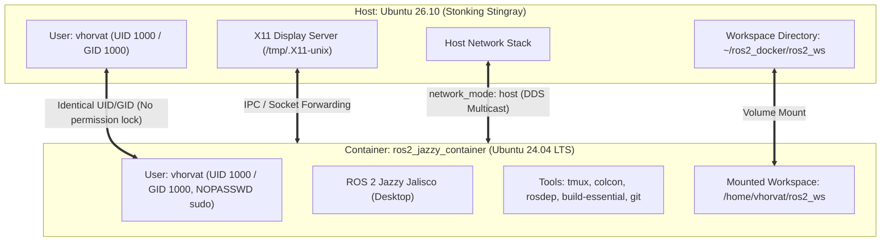

# ROS 2 Jazzy Development Environment on Ubuntu 26.10 Host

This document details the configuration, architecture, and usage of the containerized development environment for **ROS 2 Jazzy Jalisco** running on **Ubuntu 24.04 LTS (Noble Numbat)** atop an **Ubuntu 26.10** host.

---

## 1. Environment Architecture



---

## 2. Technical Specifications

| Parameter | Host Specification | Container Specification | Rationale |
| :--- | :--- | :--- | :--- |
| **Operating System** | Ubuntu 26.10 (Development Branch) | Ubuntu 24.04 LTS (*Noble Numbat*) | ROS 2 tier-1 support is pinned to LTS releases. |
| **ROS 2 Distribution** | N/A | **ROS 2 Jazzy Jalisco** | Standard LTS release for Ubuntu 24.04 (supported to May 2029). |
| **Base Image** | N/A | `osrf/ros:jazzy-desktop` | Official Open Robotics image with desktop tools pre-compiled. |
| **User ID / Group ID** | `1000:1000` (`vhorvat`) | `1000:1000` (`vhorvat`) | Prevents root ownership issues when modifying code across host/container. |
| **Network Mode** | Physical / Local network | `host` | Essential for ROS 2 DDS UDP discovery between nodes on the host & network. |
| **GUI Forwarding** | X11 / Wayland via XWayland | Passthrough via `/tmp/.X11-unix` | Allows native rendering for RViz2, Gazebo, and rqt. |

---

## 3. Directory Layout

All files are organized in `~/ros2_docker`:

```
~/ros2_docker/
├── Dockerfile          # Builds Ubuntu 24.04 image with ROS 2 Jazzy, tmux, and developer utilities
├── compose.yaml        # Docker Compose configuration (volumes, networking, devices, display)
├── install_docker.sh   # Host script to install Docker engine and configure user permissions
├── run.sh              # Interactive launcher script (handles xhost, builds, starts, and attaches)
├── README.md           # Quickstart instructions
├── ROS2_SETUP_NOTE.md  # Detailed reference note
└── ros2_ws/            # Persistent ROS 2 workspace (persisted on host filesystem)
    └── src/            # Source packages location
```

---

## 4. Key Configuration Highlights

### A. Non-Root User & Permission Alignment
In Ubuntu 24.04 base images, a default user `ubuntu` exists with UID `1000`. The Dockerfile removes this default placeholder and configures your username:
```dockerfile
# Create non-root user matching the host user UID/GID and grant passwordless sudo
RUN if id -u ubuntu >/dev/null 2>&1; then userdel -r ubuntu 2>/dev/null || true; fi && \
    if getent group ubuntu >/dev/null 2>&1; then groupdel ubuntu 2>/dev/null || true; fi && \
    groupadd --gid 1000 vhorvat && \
    useradd --uid 1000 --gid 1000 -m -s /bin/bash vhorvat && \
    echo "vhorvat ALL=(ALL) NOPASSWD:ALL" >> /etc/sudoers.d/vhorvat
```
> This ensures all files created inside the container (e.g. `colcon build` outputs or new ROS packages) remain fully editable and deletable from your host IDE (VS Code, Obsidian, etc.) without `sudo`.

### B. ROS 2 Auto-sourcing & Shell Experience
The container's `~/.bashrc` automatically sources:
1. Core ROS 2 setup: `/opt/ros/jazzy/setup.bash`
2. Colcon tab-completion: `/usr/share/colcon_argcomplete/hook/colcon-argcomplete.bash`
3. Overlay workspace: `/home/vhorvat/ros2_ws/install/setup.bash` (when built)

### C. Pre-Configured & Live-Editable `tmux`
The configuration file [`~/.tmux.conf`](file:///home/vhorvat/ros2_docker/.tmux.conf) on the host is mounted directly into `/home/vhorvat/.tmux.conf` in the container:
- **Edit anytime**: You can edit `~/ros2_docker/.tmux.conf` directly on your host (or `nano ~/.tmux.conf` inside the container) without rebuilding the container!
- **Reload instantly**: Press **`Ctrl+b` then `r`** (or run `tmux source-file ~/.tmux.conf`) inside tmux.
- **Pre-configured shortcuts**:
  - **Mouse mode**: Enabled (click panes to focus, drag to resize, mouse wheel scrollback).
  - **Intuitive splits**: `Ctrl+b` then `|` (vertical split), `Ctrl+b` then `-` (horizontal split) — both stay in the current working directory.
  - **Pane navigation**: `Alt + Arrow keys` (switch panes without pressing `Ctrl+b`).
  - **History limit**: 50,000 lines scrollback.
  - **Status bar**: Custom styled with ROS 2 Jazzy indicator and clock.

---

## 5. Setup & Operational Commands

### Step 1: Install Docker on Host (One-Time)
Because `sudo` requires interactive authentication:
```bash
cd ~/ros2_docker
./install_docker.sh
newgrp docker
```

### Step 2: Launch Environment
```bash
./run.sh
```
The script automatically:
1. Allows local X11 display connections (`xhost +local:$USER`).
2. Pulls and builds the Docker image.
3. Launches the container in detached mode.
4. Attaches an interactive shell inside `/home/vhorvat/ros2_ws`.

### Step 3: Verification Commands (Inside Container)
Check the ROS 2 environment:
```bash
ros2 doctor
```

Verify that Jazzy packages are present:
```bash
echo $ROS_DISTRO
# Output: jazzy
```

Test ROS 2 communication:
```bash
# Terminal 1:
ros2 run demo_nodes_cpp talker

# Terminal 2 (attach via second terminal or tmux pane):
ros2 run demo_nodes_py listener
```

---

## 6. Daily Workflow Cheat Sheet

| Task | Command |
| :--- | :--- |
| **Enter running container** | `cd ~/ros2_docker && ./run.sh` or `docker exec -it ros2_jazzy_container bash` |
| **Launch tmux session** | `tmux new -s main` |
| **Create ROS 2 package** | `cd ~/ros2_ws/src && ros2 pkg create --build-type ament_cmake <package_name>` |
| **Build workspace** | `cd ~/ros2_ws && colcon build --symlink-install` |
| **Test RViz2 GUI** | `rviz2` (opens native window on host display) |
| **Stop container** | `docker compose -f ~/ros2_docker/compose.yaml down` |
